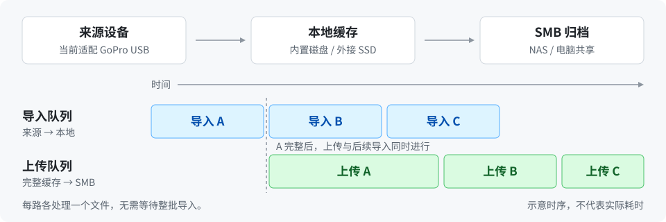

# Media Importer

**从相机导入素材，自动归档到自己的存储。**

[](https://github.com/ShuaiZha/media-importer/releases/latest)
[](https://github.com/ShuaiZha/media-importer/actions/workflows/ci.yml)

[快速开始](#快速开始) · [使用文档](docs/README.md) · [兼容性](docs/compatibility.md) · [更新记录](docs/README.md#版本说明)

连接相机，在飞书中确认备份。程序将素材收进本地缓存，并行上传到 SMB 共享；存储可以是 NAS，也可以是另一台电脑。

- **并行传输**：第一个文件完整导入后立即上传，同时继续导入后续文件。
- **离线缓冲**：SMB 离线时先缓存，相机断开后仍可上传完整文件。
- **自动整理**：按设备平铺归档，保留原文件名，重名加后缀；归档成功后清理缓存。
- **飞书控制**：从底部菜单查看状态、启停同步，配置素材、传输、通知、相机与归档存储，可选导入后删除原片。

**main 分支开发版 [v0.11.0](docs/releases/v0.11.0.md)** 加入 USB 优先的自动连接、Wi-Fi 导入、飞书拍摄控制，以及支持 Tailscale 的 WebRTC 低延迟预览。预览入口可在飞书配置和检查，业务设置统一保存在 JSON。此版本尚未发布到在线安装渠道；下方命令仍安装最新正式版 v0.10.26。



目前接入 **GoPro、SMB、飞书单聊**。USB 用于数据传输；Mac 原生版另支持 Wi-Fi 导入与蓝牙拍摄控制。HERO9 Black 已完成实机验证，其他机型与平台的验证范围见[兼容性表](docs/compatibility.md)。每个实例处理一台来源设备和一个目的地。

## 快速开始

准备 USB 数据线、可读写的 SMB 共享和[飞书应用凭据](docs/feishu.md#1-准备应用与凭据)。**以下两种部署方式任选其一；无线连接与拍摄控制目前仅支持 Mac 原生版。**

安装命令获取最新正式版本。相机状态、选择素材和清理原片已在 **v0.10.26** 提供；无线、拍摄控制与实时预览需要 **v0.11.0 开发版**。升级后还需按[飞书指南](docs/feishu.md#3-订阅与菜单)更新并发布菜单。

### 部署方式一：原生 CLI

适合直接在电脑上运行，无需 Docker 或另装 Python。

**macOS / Linux**

```sh
curl -fsSL https://github.com/ShuaiZha/media-importer/releases/latest/download/install-native.sh | sh
```

**Windows · PowerShell**

```powershell
& ([scriptblock]::Create((Invoke-RestMethod 'https://github.com/ShuaiZha/media-importer/releases/latest/download/install-native.ps1')))
```

安装命令会下载对应平台的正式包，并引导填写缓存、SMB 和飞书配置。完成后用 `media-importer status` 检查后台；若找不到命令，按安装输出设置 PATH。

更新：`media-importer update` · 卸载：`media-importer uninstall` · [完整说明 →](docs/native.md)

### 部署方式二：Docker Compose

适合已有 Docker 环境的用户。需要 Git、Python 3.9+ 和运行中的 Docker Compose。

```sh
git clone --branch v0.10.26 https://github.com/ShuaiZha/media-importer.git
cd media-importer
python3 scripts/setup.py
docker compose up -d --no-build
```

更新使用 `python3 scripts/manage.py update`；Windows 将 `python3` 换成 `py -3`。[完整说明 →](docs/deployment.md)

## 首次备份

1. 按[飞书指南](docs/feishu.md#3-订阅与菜单)完成事件、菜单和应用发布。
2. 连接已开机的相机；首次使用在确认卡中核对身份，点击「确认并备份」。开发版可先「开启同步」再等待相机连接；已确认相机恢复连接后自动备份。
3. 从飞书底部菜单操作（正式版为「状态、同步、设置」，开发版为「同步、相机、设置」）；在「设置 → 消息通知」开启自动提醒。传输期间保持电脑唤醒、缓存盘可用。

新安装默认**关闭同步、删除原片和自动通知**。首次使用建议保留原片，用少量素材验证。开启删除后，原片在整组完整导入本地后清理，远端归档前缓存可能是唯一副本。

v0.11.0 开发版的 Mac 原生无线使用方式：电脑通过有线网络访问 SMB 和飞书，相机独立供电并开启无线连接；在「相机连接」选择自动或无线。程序通过蓝牙核对身份、启动热点并自动连接，无需额外 App。详见[无线要求](docs/compatibility.md#无线连接与拍摄控制)。

Mac 原生版还可从「相机 → 实时预览」打开 HERO9 无线画面，并可在飞书「相机连接 → 预览设置」配置和检查 Tailscale 远程入口；优先使用 WebRTC，连接失败时回退兼容播放。预览组件随程序安装，持续运行至主动结束或源连接故障，无需单独运行 go2rtc 或 FFmpeg。详见[预览使用](docs/feishu.md#实时预览)。

## 文档与支持

| 我想… | 文档 |
| --- | --- |
| 修改连接、目录或传输偏好 | [配置参考](docs/configuration.md) |
| 理解进度、清理规则和处理故障 | [使用与排障](docs/operations.md) |
| 备份数据、更换电脑或恢复缓存 | [迁移与恢复](docs/recovery.md) |
| 了解实现或参与开发 | [架构](docs/architecture.md) · [贡献指南](CONTRIBUTING.md) |

问题和建议请提交 [Issue](https://github.com/ShuaiZha/media-importer/issues)，附上版本、系统与脱敏日志。请勿上传凭据、任务数据库或私人素材。

## Star 趋势

<a href="https://www.star-history.com/?repos=ShuaiZha%2Fmedia-importer&type=date">
  <picture>
    <source media="(prefers-color-scheme: dark)" srcset="https://api.star-history.com/chart?repos=ShuaiZha/media-importer&type=date&theme=dark" />
    <source media="(prefers-color-scheme: light)" srcset="https://api.star-history.com/chart?repos=ShuaiZha/media-importer&type=date" />
    
  </picture>
</a>
