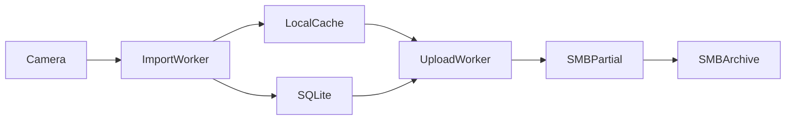

# 架构

[文档目录](README.md) · [传输规则](operations.md#传输与清理规则) · [贡献指南](../CONTRIBUTING.md)

这份说明给读代码的人。用户能看到的确认、进度、删除和故障处理以[日常使用](operations.md)为准，机型范围以[兼容性](compatibility.md)为准。这里只说明模块为什么这样分，以及哪些边界不要为了变短而拆掉。

当前是一台电脑、一台来源、一个归档目的地。原生 CLI 和 Docker 共用 `media_importer`，差别只在进程怎么被拉起、配置从哪里读。

## 一个文件怎么走

导入和上传各有一个线程，一次只处理一个文件。交接物是缓存盘上的完整文件和 SQLite 里的任务行，不是进程内队列。相机拔掉或 SMB 断开时，已经下完的文件留在缓存里，上传线程可以继续。

入口在 [`runtime.py`](../media_importer/runtime.py) 的 `daemon`。它拉起发现、心跳、通知和元数据快照，再循环调用 [`service.py`](../media_importer/service.py)。两条传输线程在 [`pipeline.py`](../media_importer/pipeline.py)。

一个新文件的顺序是：

1. 发现线程确认这台相机可以读。
2. 导入线程扫清单，按素材身份建任务，整文件写入 `*.download`，同时计算 SHA-256。
3. 大小和来源身份通过后，改名为 `{任务 id}.bin`，校验值写入任务行。
4. 上传线程把缓存按顺序再读一遍并再算 SHA-256。不一致就停止这一份，保留缓存。
5. 字节写到 SMB 的隐藏 `.partial`。核对大小和 SMB 文件身份后，不覆盖地改成正式名。
6. 任务记为已上传，再删除对应缓存。中断的半截文件下次从头传。

SMB 不把归档文件读回来。同一个文件的列目录、上传和改名共用一条连接，文件结束后断开。

## 模块各管一件事

| 模块 | 只管 |
| --- | --- |
| [`adapters/gopro.py`](../media_importer/adapters/gopro.py) | 发现、清单、下载、素材分组、原片删除的设备差异 |
| [`adapters/smb.py`](../media_importer/adapters/smb.py)、[`smb_transport.py`](../media_importer/adapters/smb_transport.py) | 连接、整文件写入、不覆盖改名、只删除能确认身份的临时文件 |
| [`adapters/feishu.py`](../media_importer/adapters/feishu.py)、[`bot.py`](../media_importer/bot.py) | 只接受配置中的那个用户；卡片令牌留在本机 |
| [`source_connection.py`](../media_importer/source_connection.py) | 本次相机是否已确认。重启保留同一序列号的批准，并作废旧卡片 |
| [`service.py`](../media_importer/service.py) | 单个文件的导入、上传、归档和原片删除判断 |
| [`store.py`](../media_importer/store.py) | 任务、状态和锁 |
| [`storage.py`](../media_importer/storage.py) | 缓存盘是否仍是原盘，以及抽样是否对得上 |
| [`lifecycle.py`](../media_importer/lifecycle.py) | 一轮归档及必要清理结束后，移除任务明细，只保留必要的去重索引与待发送结果 |
| [`notifications.py`](../media_importer/notifications.py) | 飞书出站队列。发送失败不改变传输结果 |
| [`native/`](../media_importer/native/) | 安装、更新、卸载和登录后启动。不参与单个文件的对错 |

设备差异停在适配器里。传输、确认、缓存和归档记录是共用的，见 [`contracts.py`](../media_importer/contracts.py)。

## 为什么任务要记好几遍

这些表记的是不同时刻的事实，不是同一份清单的复制品。

| 记录 | 留下它的原因 |
| --- | --- |
| `files` | 尚未收尾的素材任务；整轮归档及必要清理完成后移除 |
| `source_groups` | 哪些文件必须一起看完才能删相机原片 |
| `batches`、`transfer_runs` | 这一轮什么时候算导入完成、归档完成，通知要指哪一轮 |
| `source_index` | 保留原片时留下素材身份及归档依据，避免重复导入；完整扫描确认原片已不存在后移除 |
| `destination_anchor` | 目的地地址变了之后，用一个已归档文件证明还是原来的共享。对上之后不再逐个检查历史文件 |
| `.receipts/` | 数据库坏掉时，仍能从缓存文件认回任务 |

[`lifecycle.py`](../media_importer/lifecycle.py) 的 `settle` 在两路传输停止后收尾：确认整轮及素材组均完成归档与必要清理，在同一事务中冻结待发送结果、保留去重索引和归档锚点，再移除文件、分组与批次明细。尚有完整缓存、待清理临时文件、清理错误或删除结果不确定时不收尾。通知失败只保留独立的待发送结果，不阻止任务明细清理，也不重新上传。

升级会将旧的已收尾标记转换为不补发通知的记录；这些记录仍须通过上述检查才能移除。未完成任务和缓存不重建，已有归档不修改。去重使用素材身份，不使用目的地里的同名文件或相同大小。

## 不要改掉的边界

- 正式归档不覆盖已有文件。同名加后缀。
- 删原片默认关闭，而且只在整组都有完整副本之后。它不等 SMB 传完。
- 导入和上传的 SHA-256 不一致时停止，并保留缓存。
- 同一份数据目录同一时间只有一个传输进程。
- 飞书不能改连接和凭据。凭据只在 `.env`。
