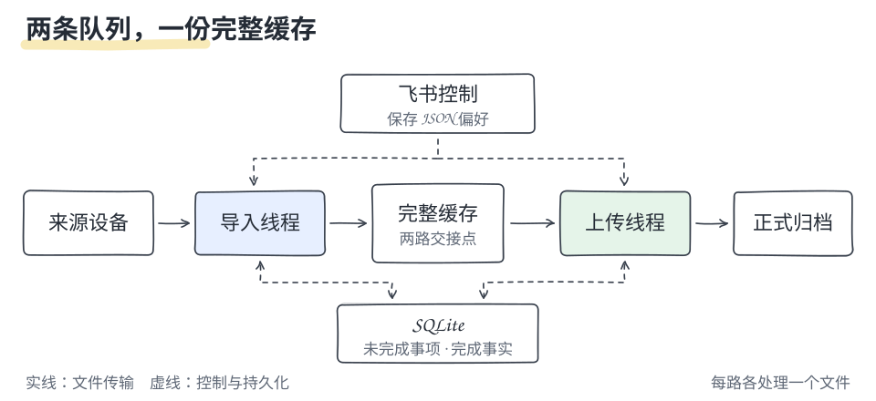
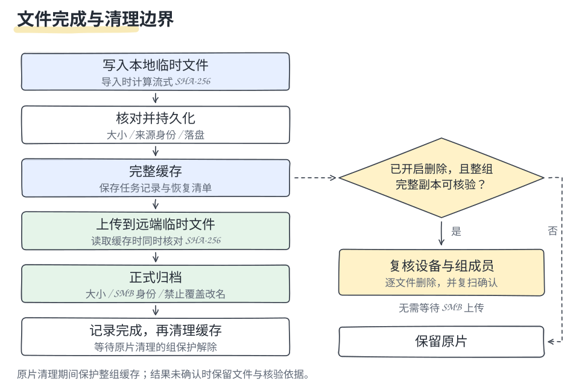

# 架构

[文档目录](README.md) · [贡献指南](../CONTRIBUTING.md)

一个实例管理一个来源、一个缓存目录和一个目的地。原生 CLI 与 Docker 共用核心，只负责不同的进程管理方式。用户行为以[传输规则](operations.md#传输与清理规则)为准。

## 两条并行队列

实线为文件传输，虚线为记录与控制。两路各一次处理一个文件，以完整缓存和持久化任务交接。SMB 离线不阻止额度内导入，来源断开不阻止完整缓存上传。

## 设备、连接与拍摄

稳定身份为「适配器类型 + 完整序列号」，与地址和链路无关。连接会话包含实际端点、固件与可访问性，变化时使旧卡片失效。USB 与 Wi-Fi 使用相同媒体导入核心；蓝牙仅用于身份、热点与拍摄控制，SMB 不依赖相机会话。

Mac 无线工作放入可终止的子进程。凭据只在该进程中读取；连接检查有上限，失败按既有间隔重试。拍摄请求先持久化，导入线程取消当前临时下载后执行；上传线程继续。快门不自动重发，崩溃后只查询实际状态。控制结果短期保留，不新增历史查询体系。

每个实例仍只有一台相机、一个目的地，拍摄与预览按适配器能力开放。预览由独立受管会话运行；相机协调器让导入和原片清理等待，完整缓存仍可上传；相机 MPEG-TS 经内部 Python 进程直接交给内置 go2rtc，不转码、不落盘，客户端优先使用 WebRTC，失败后回退到原生 HLS / MSE。内部管理接口监听本机随机端口；只读播放网关经 Tailscale Serve 提供 HTTPS/WSS，WebRTC 媒体端口只绑定本机或本机 Tailscale 私有地址。关闭观看端不结束会话；源连接中断、父进程退出或后台重启时回收，停止结果未知时阻止新的相机读取和删除。

主循环与导入文件边界共用 `camera_coordinator.dispatch` 的调度顺序和相机占用策略。导入线程只准备选定清单，外层循环才可启动选定传输，避免递归开启另一套队列。直播恢复待核验时继续保留相机占用；完整缓存上传不依赖这项资源。

## 一个文件的完成边界

原片清理与上传可并行；清理源文件期间保护该组缓存。归档改名结果未知时进入发布恢复，不按半文件清理。中断的传输从头开始，不重复处理已经完成的文件。

缓存保护按文件登记，扫描、删除等相机网络操作期间延迟该组缓存清理；无关文件可继续归档并释放缓存。短锁只覆盖缓存变更与保护登记，删除前仍现场核验完整副本；删除意图与恢复依据继续持久化。

素材去重使用适配器提供的稳定身份。HERO9 的媒体接口创建时间可能随重启漂移；扫描和传输核验统一以 MP4 文件头的创建时间为准，同时检查 GUMI、大小及文件状态。关联预览文件继承该时间，不凭文件名或大小认领已有归档，也不重建任务 ID。

导入 SHA-256 与上传顺序读取的校验值比较；旧缓存没有该值时仍能处理。卷、大小、时间和内容抽样另作缓存身份依据。远端视频不完整读回，同一文件的 SMB 操作复用连接。

## 模块职责

| 模块 | 职责 |
| --- | --- |
| [runtime](../media_importer/runtime.py) / [pipeline](../media_importer/pipeline.py) | 后台生命周期、两路调度与故障恢复 |
| [service](../media_importer/service.py) | 导入、归档与原片清理条件 |
| [contracts](../media_importer/contracts.py) / [adapters](../media_importer/adapters/) | 通用接口与 GoPro、SMB、飞书差异 |
| [connections](../media_importer/connections.py) / [source_connection](../media_importer/source_connection.py) | 连接策略、稳定身份、设备信任与旧会话失效 |
| [camera_coordinator](../media_importer/camera_coordinator.py) / [camera_state](../media_importer/camera_state.py) | 统一操作准入、来源调度和只读相机事实；归档不占用相机 |
| [source_session](../media_importer/source_session.py) | 每次来源 IO 绑定当前 USB / Wi-Fi 会话，不重建 SMB 上传线程 |
| [radio](../media_importer/radio.py) / [capture](../media_importer/capture.py) | 有超时限制的原生无线进程、拍摄意图与实际结果 |
| [gopro_capture](../media_importer/adapters/gopro_capture.py) / [capture_forms](../media_importer/capture_forms.py) | 适配器读取预设和可用值；通用表单展示能力，不硬编码相机参数组合 |
| [capture_sessions](../media_importer/capture_sessions.py) | 仅保留最近一次拍摄前后清单，新增文件复用选择导入；不另建传输引擎 |
| [camera_web](../media_importer/camera_web.py) / [camera_page](../media_importer/camera_page.py) / [camera_library](../media_importer/camera_library.py) | 本人控制页面、复用拍摄队列；有界素材读取在来源 IO 边界执行，不另建归档记录 |
| [camera_operations](../media_importer/camera_operations.py) / [camera_cards](../media_importer/camera_cards.py) | 一次性相机查询、清理预览与确认回执；复用来源适配器和清理核验 |
| [selected_imports](../media_importer/selected_imports.py) / [selected_transfer](../media_importer/selected_transfer.py) / [selected_cards](../media_importer/selected_cards.py) | 固定所选素材范围，复用两路传输、停止恢复与同卡进度 |
| [live_preview](../media_importer/live_preview.py) / [preview_worker](../media_importer/preview_worker.py) / [preview_cards](../media_importer/preview_cards.py) | 按需预览会话、子进程回收与飞书入口；Mac 包内置 go2rtc |
| [store](../media_importer/store.py) / [storage](../media_importer/storage.py) | 任务、锁、缓存盘与副本核验 |
| [lifecycle](../media_importer/lifecycle.py) | 完成后收尾，保留必要去重与待发结果 |
| [database](../media_importer/database.py) | 启动时初始化与迁移；运行连接只检查格式，不建表或创建数据库 |
| [completion](../media_importer/completion.py) / [outbox](../media_importer/outbox.py) | 与文件变更同时保存完成事实；收尾时冻结待发结果，不依赖飞书排版与发送 |
| [bot](../media_importer/bot.py) / [notifications](../media_importer/notifications.py) | 本人交互、发送队列与失败重试 |
| [native](../media_importer/native/) | 安装、更新、卸载与系统服务 |

## 持久化与收尾

| 记录 | 用途 |
| --- | --- |
| `files`、`source_groups` | 未收尾任务、素材关联和删除事实 |
| `batches`、`transfer_runs` | 本轮完成条件与通知归属 |
| `task_results` | 与任务变更同时保存的完成摘要，随任务收尾删除 |
| `notification_events` | 待发送结果、重试和原卡更新依据，不参与归档判定 |
| `source_index` | 保留原片时去重；完整扫描确认原片不存在后移除 |
| `destination_anchor` | 连接地址变化后核验逻辑目的地 |
| `.receipts/` | 数据库损坏时重建完整缓存任务 |
| `camera_operations` | 短期清理清单、确认与删除意图；结果不确定时保留待复查依据 |
| `capture_requests` | 短期拍摄意图、幂等标识与结果；已发命令不重放 |
| `selected_imports` | 本次选择、确认版本与短期结果；未完成的选定任务保留恢复范围 |

两路停止后，`settle` 在同一事务中冻结待发结果、保留去重与归档依据，再删除已完成明细。有完整缓存、待清理临时文件、清理错误或删除结果未知时不收尾。通知失败独立重试，不重新上传。

全量与选定任务共用 `retirement_ready` 和 `retire_rows`，由调用方固定范围并先保存完成结果。`task_facts` 统一导入、正式归档及两项清理事实，不执行 IO 或授权删除；归档完成与允许收尾仍是不同边界。

数据库初始化只从启动、检查、恢复等明确入口执行，普通 `Store` 连接不建表、不迁移、不创建缺失数据库。相机页面的状态、结果和媒体查询使用只读连接，不唤醒传输；查询不需要取得写事务。

`task_results` 是未收尾任务的完成摘要，与文件状态在同一事务中更新；不保存历史明细。通知只读取摘要、排版并发送，不再扫描文件表推断完成。任务收尾与待发结果原子提交，发送失败独立重试；完成结果与清理结果分别表达，收尾后摘要随任务删除，待发结果保留到发送成功。

同一份数据仅一个传输实例。业务配置只有 JSON 一个来源；`.env` 仅保存部署字段与飞书首次连接凭据，SMB 密码只存本机 `credentials/`；JSON 和控制队列只保存随机引用，连接检查通过后才原子切换。更新快照、备份与迁移包含凭据文件。素材身份决定去重，归档禁止覆盖，源清理、归档和缓存清理分别记录，不能相互替代。

手动相机操作使用现有导入线程的文件边界；备份关闭时由空闲后台执行，不新增常驻线程。清理预览只读核验并固定清单，确认绑定本人、连接会话和配置版本，执行时再次核验。服务中断后仅复查已发出的删除结果，未执行部分需要重新确认；与自动清理共用组缓存锁。

选定导入必须在全量备份停止后执行，独立记录本次范围但共用传输核心。每个主文件独立选择，直接附属文件按归档设置处理；清理边界仍由适配器的完整素材组决定。选定任务固定保留原片，停止和继续不扩大范围、不改变全量备份开关。完成后只收尾本次文件，未选任务与缓存保持原状；升级前已确认的分组任务仍按原清单恢复。

### 相机与播放边界

`camera_coordinator` 负责来源占用和预览线程生命周期，`host_network` 负责宿主机联网和只读 Serve 检查；适配器负责具体相机协议。`preview_access` 的 `/view/` 仍只接收 WebRTC / MSE 协商和媒体字节，不接受任意流地址、管理 API 或拍摄命令。`preview_rtc` 选择私有监听地址并限制协商格式，`preview_player` 负责播放与兼容回退。停止后立即撤销会话链接，回收媒体进程以关闭视频通道。

同一网关的 `/camera/` 使用独立的本人控制令牌，绑定已确认设备、1 小时有效期和同源 WebSocket；旧观看令牌不能控制相机。拍摄仍写入现有 `capture_requests` 队列，预览仍交给 `live_preview`。素材读取用有界内存队列交给导入线程，在相机 IO 边界执行；每段最多 1 MiB，缩略图最多 2 MiB，复核主文件身份和附属关系。浏览占用通过短期续约阻止导入、原片清理，不阻止上传，关闭页面或续约失效即释放；不增加磁盘视频缓存或传输记录。

`bot_routes` 将稳定菜单事件和文字命令映射到既有应用入口。读取拍摄状态使用带时间的快照，不取消正在导入的文件；新的停止录像意图取消尚未执行的旧拍摄意图，并让出普通蓝牙连接任务。预览转录像必须等待预览停止确认；发送后的未知结果只复查，不重放快门命令。

### 配置的唯一来源

`config_upgrade` 仅负责 version 4 的一次性迁移；正常后台只读取 version 5 的 JSON，不再合并环境连接字段。相机发现结果作为运行状态保存在 SQLite，不反写用户的 USB 地址提示。配置更新有版本校验和文件锁；迁移先保存旧文件及凭据，保留逻辑目的地身份。

`preview_settings` 负责观看入口校验与只读宿主机诊断，`bot_settings` 负责表单，`preview_access` 热更新允许的访问域名。修改预览配置不重建传输客户端；正在预览或停止结果未确认时不允许改地址。原生包与发行清单的 `config_version: 4` 表示最低可迁移的输入格式，`settings_version: 5` 表示新运行格式，以便旧安装器先只读验证、停止服务后再升级。

配置解析复用文件身份未变的文档，每次检查元数据、至多一秒重新读取；运行设备绑定每次单独读取，返回值彼此隔离。相机主动观测与后台监测共用读取逻辑，RTMP 占用期间不继续探测已切换的相机 HTTP 链路。展示缓存不参与删除与归档的最终核验。

### 飞书命令与消息

`bot_routes.COMMANDS` 统一菜单、文字别名和命令入口，`MENUS` 规定分组与顺序。查询不启动备份、预览或拍摄；设备确认只记录授权。旧事件继续路由到对应入口。

`message_facts` 计算全量与选定任务共用的进度事实，`bot_cards` 和各操作卡片负责摘要／详情排版。百分比到达 100% 不能替代正式归档记录；清理结果单独表达。显示时间按 UTC+8 转换，存储时间保持原格式。

命令复用持久化队列与回调标识去重，同一操作更新原回执。开启备份创建或复用本轮进度卡，通知关闭不取消主动回执；完成和需人工处理的故障另发消息，恢复更新原异常卡。短期结果沿用现有有限摘要，不恢复历史任务查询。

### 有声直播

`live_preview` 继续持有唯一画面会话，以 `mode` 区分无声预览与 RTMP 直播。`livestream_worker` 管理本地接收与音频子进程，`gopro_livestream` 封装相机入网、直播和状态核验；`livestream_network` 只读识别本机网络，不修改互联网共享。视频直接转封装，仅音频转为 WebRTC 所需的 Opus。

直播独占蓝牙和相机读取资源，连接扫描与拍摄命令不抢占；上传队列独立运行。开始改变相机状态前原子保存恢复记录，只有直播停止、原参数与热点均确认恢复后才删除记录。启动失败、停止、断线或父进程退出均执行相同恢复路径，未知结果保留待核验状态。Wi-Fi 密码绕过任务队列，以既有本机凭据引用保存，迁移备份包含该引用对应的文件。
