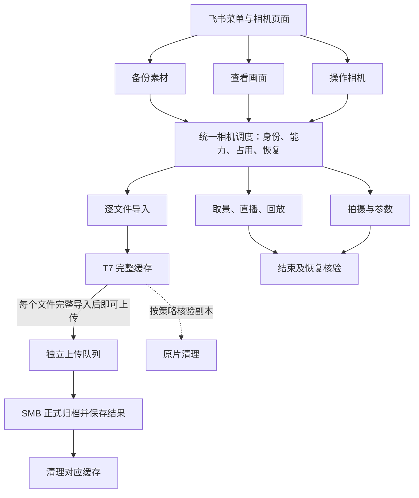

# 业务流程

[文档目录](README.md) · [架构](architecture.md)

## 入口

| 目标 | 入口 | 行为 |
| --- | --- | --- |
| 备份素材 | 备份 → 开启备份／选择文件；相机素材页 → 备份所选文件 | 自动发现或固定选择范围，逐文件导入并并行归档 |
| 查看画面 | 相机 → 相机页面 | 实时取景、有声直播、素材回放；打开页面不启动画面 |
| 操作相机 | 相机 → 相机页面／清理原片 | 拍摄、参数及经预览确认的手动清理 |

相机状态读取当前快照；设备详情可主动核验。连接相机只建立连接，确认相机只授权设备，均不改变备份开关。v0.11.6 起“同步”对外称为“备份”，原事件键与文字命令继续接受。

相机素材页的选择经预览确认后进入现有单次备份队列，不另建传输流程。提交时结束回放、释放浏览占用；选择范围及预览文件策略冻结，原片固定保留。全量备份开启时需先停止，页面不会自行切换开关。

## 相机占用

| 用途 | 新的导入与自动清理 | 完整缓存上传 |
| --- | --- | --- |
| 空闲 | 按备份开关执行 | 按备份开关执行 |
| 实时取景、浏览回放 | 等待；结束后按原开关恢复 | 继续 |
| 有声直播 | 等待；拍摄控制也等待连接恢复 | 继续 |
| 录像、延时摄影 | 等待；允许停止拍摄与支持的拍摄中操作 | 继续 |
| 原片清理 | 在相机 IO 边界顺序执行 | 继续，受保护缓存延迟清理 |
| 停止结果未知 | 先重新连接、刷新或复查；不重放写命令 | 继续 |

连接、相机用途、自动备份开关和两路进度分别展示。直播期间不以素材 HTTP 接口的可访问性判断相机离线。缺失或过期的拍摄状态显示未知；旧的录像事实和未知停止结果不能仅凭超时解除保护。

## 完成与停止

- 导入完成：本轮范围完整缓存或已归档，清单复核完成，相机读取结束。
- 归档完成：上传成功、大小一致、禁止覆盖的正式改名成功，记录已保存。缓存清理单独报告。
- 停止备份：传输及原片清理停止，录像、取景和直播由各自停止入口控制。
- 结束画面：停止结果、组件回收及必要的连接恢复得到核验；未知结果保留占用与恢复依据。
- 拍摄结果：依据相机实际观测核验，发送成功不代表拍摄完成；崩溃后只复查，不重放快门。
- 收尾：待发结果已持久化、保护条件满足后清理任务明细，保留必要去重信息。通知失败独立重试。

开启备份后，本轮完成进入等待新素材，开关保持开启。关闭页面不结束正在运行的画面或录像。Mac 热点由系统设置管理；直播结束后关闭热点，再恢复原相机连接。

## 副本保护

单个 MP4 独立选择，关联关系仅约束副本核验和删除。完整导入持久化后，才允许按配置清理原片；未归档时缓存可能是唯一副本。当前无线连接保留原片，已验证的 USB 连接仍须核对型号、固件、源身份和完整副本。删除使用单文件接口并复查，结果未知不得重发。

中断文件从头传输，完整缓存保留，已有归档不覆盖。远端大小与身份核验沿用现有规则，不增加视频全量读回。配置、任务身份、目的地与归档路径不变。
